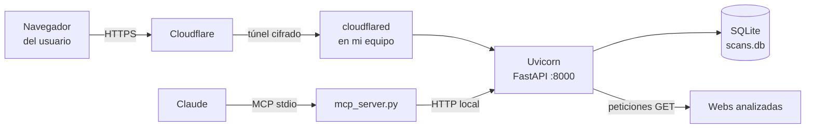
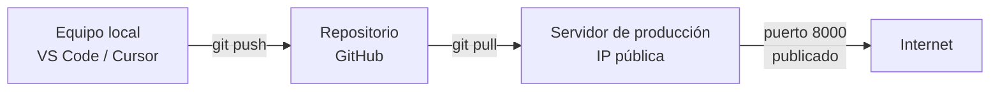

# WebScan

Analizador de seguridad web. Escribes una dirección y la herramienta comprueba su configuración de HTTPS, cabeceras de seguridad, cookies y TLS, le pone una nota de 0 a 100 (y una letra de A a F) y guarda el historial de todos los análisis.

Incluye una API REST documentada, una página web sencilla y una herramienta MCP para poder pedirle análisis directamente a Claude.

## Qué es

- **`main.py`** — API (FastAPI) con 6 endpoints y base de datos SQLite.
- **`static/index.html`** — página web que consume la API.
- **`mcp_server.py`** — servidor MCP que envuelve la misma API como herramientas invocables desde Claude.

## Instalación

Requiere Python 3.10+ (probado en 3.12 y 3.14).

```bash
git clone https://github.com/cballesta11/WEBSCAN.git
cd WEBSCAN
python -m venv venv

# Windows
venv\Scripts\activate
# Mac / Linux
source venv/bin/activate

pip install -r requirements.txt
```

## Uso

### 1. Arrancar la API

```bash
uvicorn main:app --reload
```

- Web: http://127.0.0.1:8000
- Documentación interactiva (Swagger): http://127.0.0.1:8000/docs

La base de datos `scans.db` se crea sola la primera vez que arranca.

### 2. Los 6 endpoints

| Método | Ruta | Qué hace |
|---|---|---|
| `POST` | `/scans` | Analiza una URL y guarda el resultado |
| `GET` | `/scans` | Lista el historial, filtrable por `domain` y `min_score` |
| `GET` | `/scans/{id}` | Informe completo de un análisis |
| `GET` | `/scans/{id}/recommendations` | Solo las mejoras pendientes |
| `DELETE` | `/scans/{id}` | Borra un análisis |
| `GET` | `/stats` | Total de análisis, nota media y reparto por letra |

Puntuación (sobre 100): HTTPS 20 pts · Cabeceras de seguridad 50 pts · Cookies 15 pts · TLS 15 pts.

### 3. Usarlo como herramienta MCP desde Claude

Con la API ya arrancada en otra terminal:

```bash
claude mcp add webscan -- python mcp_server.py
```

Esto expone 6 herramientas (`analyze_url`, `list_scans`, `get_scan`, `get_recommendations`, `delete_scan`, `get_stats`) que Claude puede invocar directamente, por ejemplo: *"analiza github.com con webscan y dime qué le falta"*.

Si la API corre en otra máquina o puerto, cambia la variable de entorno `WEBSCAN_URL` (por defecto `http://127.0.0.1:8000`).

### 4. Protección contra SSRF

La herramienta rechaza analizar direcciones internas (`localhost`, `127.0.0.1`, IPs privadas, etc.), incluso si aparecen tras una redirección. Esto evita que alguien use el analizador como puerta de entrada hacia la propia red del servidor.

## Despliegue

Este proyecto se despliega **en local**, publicado hacia internet con un **túnel de Cloudflare**, sin necesidad de contratar un servidor.

```bash
# con la API ya corriendo en el puerto 8000
cloudflared tunnel --url http://localhost:8000
```

Esto genera una URL pública de tipo `https://algo-aleatorio.trycloudflare.com` que redirige el tráfico hacia tu equipo. El vídeo de demostración adjunto muestra la aplicación funcionando a través de esa URL.

### Arquitectura



1. El usuario entra en la URL pública que da Cloudflare.
2. Cloudflare reenvía el tráfico, cifrado, a través del túnel hasta el proceso `cloudflared` que corre en mi equipo.
3. `cloudflared` entrega la petición al servidor Uvicorn, que ejecuta la API FastAPI en el puerto 8000.
4. La API consulta o escribe en SQLite y, cuando analiza una URL, hace peticiones HTTP a la web objetivo.
5. En paralelo, Claude puede invocar las mismas funciones a través del servidor MCP, que llama a la API local por HTTP.

### Flujo de desarrollo → producción (alternativa con servidor propio)

Aunque este proyecto usa Cloudflare Tunnel, el flujo habitual con un servidor de producción (por ejemplo en Hetzner) sería:



1. Se desarrolla y se prueba en local.
2. Se sube el código a GitHub con commits regulares.
3. Se genera un par de claves SSH (RSA): `ssh-keygen -t rsa -b 4096`.
4. Se copia la clave **pública** al servidor (`ssh-copy-id` o pegándola en `~/.ssh/authorized_keys`).
5. Se conecta por SSH usando la clave **privada**, sin usuario ni contraseña: `ssh -i clave_privada usuario@ip-del-servidor`.
6. En el servidor se hace `git pull` para traer el código y se arranca la aplicación, publicando el puerto correspondiente hacia el exterior.

> **Nota de seguridad:** la clave privada nunca se comparte ni se sube al repositorio; es el elemento más sensible de todo el proceso, y SSH con claves es también un mecanismo habitual de persistencia en el acceso a sistemas.

## Estructura del proyecto

```
WEBSCAN/
├── main.py              # API: endpoints, lógica de análisis, SQLite
├── mcp_server.py         # Servidor MCP, envuelve la API
├── static/
│   └── index.html        # Interfaz web
├── requirements.txt
└── .gitignore
```
